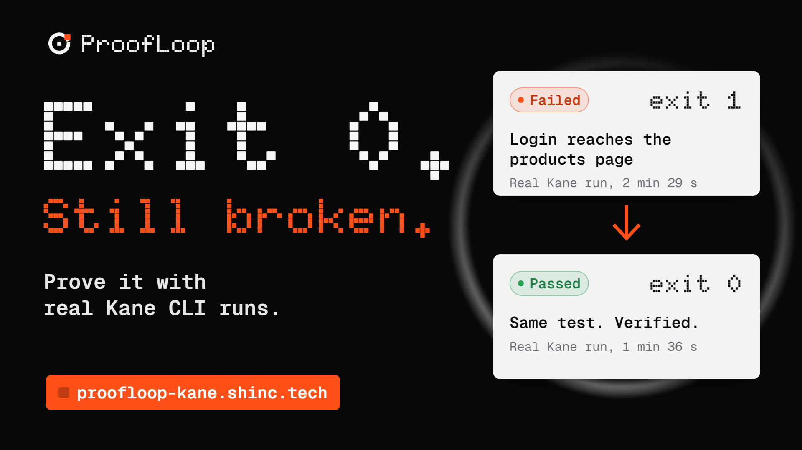
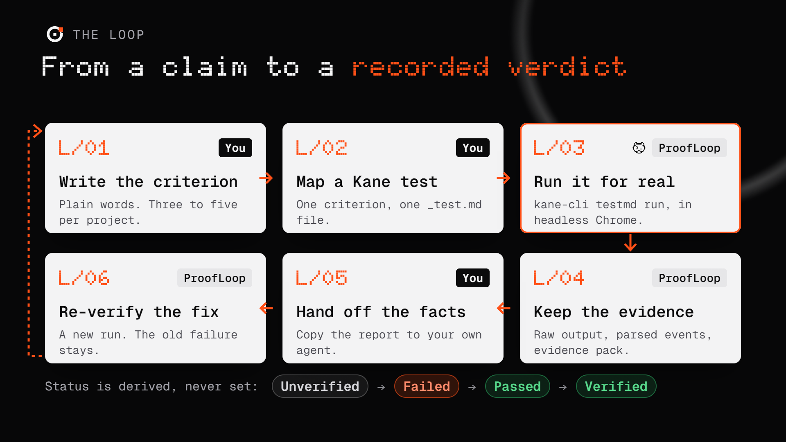
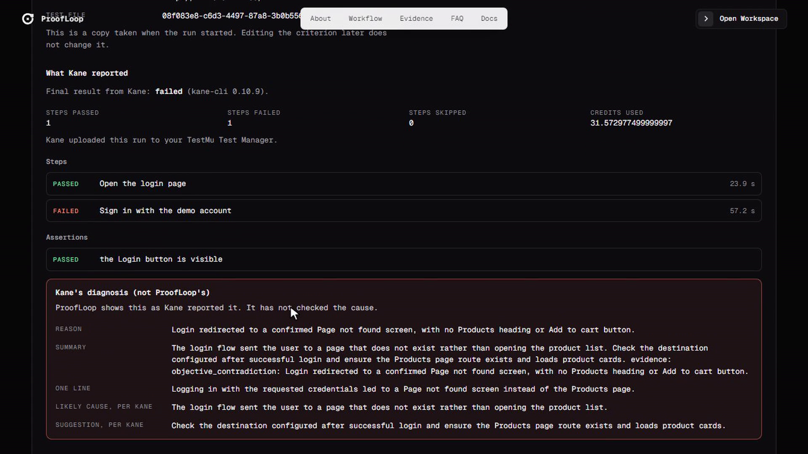
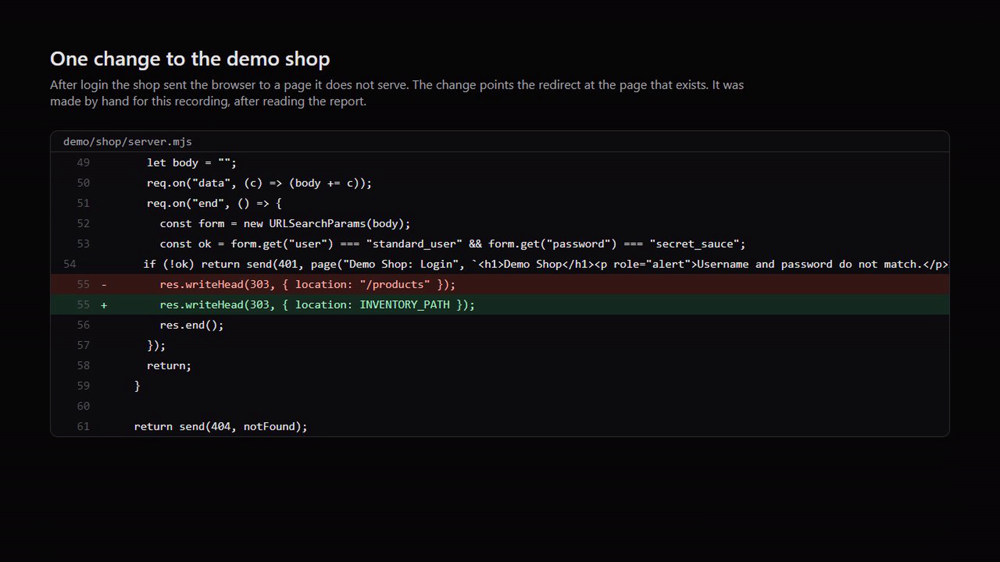
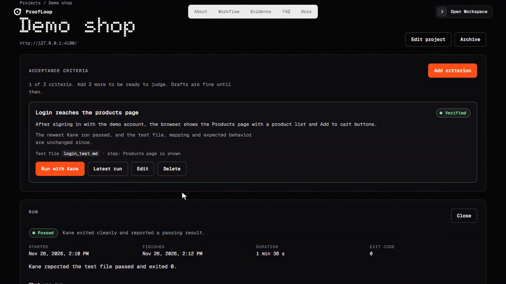
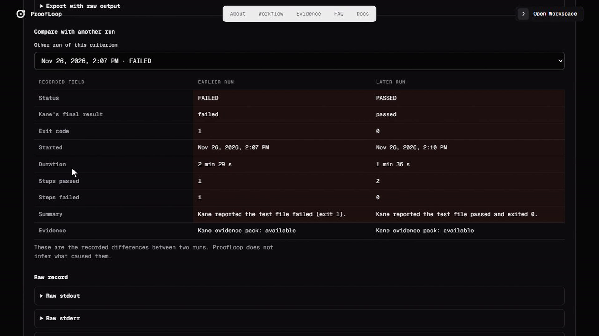
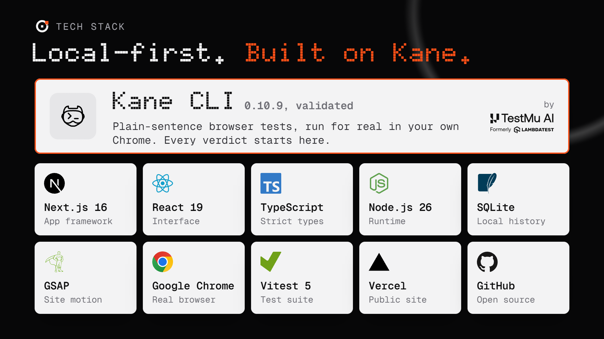
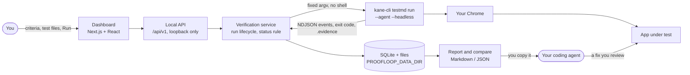

<p align="center">
  
</p>

<h1 align="center">ProofLoop</h1>

<p align="center">
  <strong>Prove it. Then ship.</strong><br>
  A local-first workspace that turns your acceptance criteria into real <a href="https://www.testmuai.com/">Kane CLI</a> browser runs, keeps the evidence, and gives your coding agent a factual report to fix from.
</p>

<p align="center">
  <a href="https://proofloop-kane.shinc.tech">Live site</a> ·
  <a href="https://proofloop-kane.shinc.tech/run-locally">Run it locally</a> ·
  <a href="https://proofloop-kane.shinc.tech/test-examples">How to write a Kane test</a> ·
  <a href="https://youtu.be/6n5tAeZ54p4">Demo video</a>
</p>

<p align="center">
  Built for the <strong>KaneCLI Online Hackathon</strong> · Validated on <code>kane-cli 0.10.9</code> · Runs only on your machine
</p>

---

## Contents

- [The problem](#the-problem)
- [The solution](#the-solution)
- [How it works](#how-it-works)
- [How we use Kane CLI](#how-we-use-kane-cli)
- [Demo: a real bug, a real FAIL, a real PASS](#demo-a-real-bug-a-real-fail-a-real-pass)
- [Features](#features)
- [Tech stack](#tech-stack)
- [Quick start](#quick-start)
- [Architecture](#architecture)
- [Security and privacy](#security-and-privacy)
- [Honest limits](#honest-limits)
- [Testing](#testing)
- [Documentation](#documentation)
- [Developer reference](#developer-reference)
- [License](#license)
- [Acknowledgements](#acknowledgements)

---

## The problem

AI coding agents write code fast. Knowing the code works is still your job, and the usual loop breaks in four places:

1. **The requirement lives in a chat.** Nothing ties it to a test you can run again.
2. **The evidence disappears.** Logs, exit codes and screenshots are gone by the next run.
3. **The agent hears "test failed."** With no expected or observed behavior, it guesses.
4. **After the fix, the failure is gone.** There is no before and after to compare.

And a green exit code proves less than it seems. A test process can exit `0` while a user who logs in lands on "Page not found."

## The solution

ProofLoop closes that loop around one idea: **a claim about your app only counts after a real browser run backs it up.**

- You write one **acceptance criterion** in plain words.
- You map it to one **Kane test file**: plain sentences in a Markdown file you can read, review and commit.
- ProofLoop runs the **real Kane CLI** in your own Chrome and **records everything**.
- It builds a **factual report** (expected behavior, what Kane observed, exit code, evidence references) that you copy to your own agent.
- After you review the fix, you **run again**. The old failure stays on record and you can compare the two runs.
- A criterion shows **Verified** only after a real passing run, and only while the test and the criterion are unchanged.

ProofLoop never edits your code, never calls your agent, and never sends anything anywhere. You stay in control of every handoff.

## How it works

<p align="center">
  
</p>

| Step | What happens | Who |
|---|---|---|
| **L/01 Write the criterion** | A title and the behavior you expect, in plain words. Three to five per project. | You |
| **L/02 Map a Kane test** | Point the criterion at one `_test.md` file. One criterion, one file, so a pass means exactly one thing. | You |
| **L/03 Run it for real** | ProofLoop starts `kane-cli testmd run` in headless Chrome and waits for the process to close before deciding anything. | ProofLoop + Kane |
| **L/04 Keep the evidence** | Raw stdout and stderr, parsed events, Kane's evidence pack, a snapshot of the criterion, the redacted command. History is append-only. | ProofLoop |
| **L/05 Hand off the facts** | Copy or download a Markdown or JSON report. Nothing is sent for you. | You |
| **L/06 Re-verify the fix** | A new run is a new record. Compare any two runs of a criterion. | ProofLoop |

A criterion's status is **derived, never set**: `UNVERIFIED`, `FAILED`, `BLOCKED` or `VERIFIED`.

## How we use Kane CLI

Kane CLI is the judge. ProofLoop is the memory and the handoff around it.

| Where Kane CLI appears | What we do with it |
|---|---|
| **Test authoring** | Tests are Kane Markdown test files (`_test.md`): front matter (`mode`, `url`, `max_steps`) plus plain-sentence steps. See [`demo/shop/login_test.md`](demo/shop/login_test.md). |
| **Execution** | ProofLoop starts `kane-cli testmd run <file> --agent --headless` with one fixed argument list, **no shell**, an allow-listed environment and a per-run folder. |
| **Result parsing** | `--agent` makes Kane print NDJSON events. ProofLoop parses them defensively (unknown events are kept, not dropped) and reads the final `test_md_done` event. |
| **Pass rule** | `PASSED` needs exit code `0` **and** Kane's final event reporting passed. Exit `1` is `FAILED`, exit `2` is `NOT_STARTED`. A timeout, a cancel, a missing final event or a test edited mid-run is never a pass (`TIMED_OUT`, `CANCELED`, `UNKNOWN`). |
| **Diagnosis** | When a run fails, Kane's own reason, summary and suggestion are shown in a box titled "Kane's diagnosis (not ProofLoop's)". ProofLoop does not check the cause. |
| **Evidence** | Kane's `.evidence` pack is copied only after ProofLoop confirms it exists and is a real zip. No guessed paths, no promised video. |
| **Account and credits** | Credentials stay in Kane's own profile (`kane-cli login`). Each run uses Kane credits and is uploaded to your TestMu Test Manager. ProofLoop shows both facts before a run starts and never estimates cost. |

The six run outcomes, and only one is a pass:

| Outcome | Meaning |
|---|---|
| `PASSED` | Kane exited 0 and its final event reported passed. Both must agree. |
| `FAILED` | Kane exited 1 and its final event reported failed. Kane's reason is kept and labeled as Kane's. |
| `NOT_STARTED` | Kane exited 2 before running, or could not be started (parse, file, auth, Chrome). |
| `TIMED_OUT` | The run passed ProofLoop's time limit and the process tree was stopped. |
| `CANCELED` | You stopped it. Recorded once the process is seen to close. |
| `UNKNOWN` | Anything that disagrees or cannot be confirmed. Never a pass. |

## Demo: a real bug, a real FAIL, a real PASS

The repo includes a tiny demo shop ([`demo/shop`](demo/shop)) with one planted bug: after a valid login it redirects to `/products`, a page that does not exist. Everything below is a real recording, with real Kane runs.

| Run | Result | Exit code | Duration |
|---|---|---|---|
| 1, before the fix | **FAILED** | 1 | 2 min 29 s |
| 2, after a one-line fix | **PASSED** | 0 | 1 min 36 s |

**1. Kane fails the run, and says why.** Kane reported that login redirected to a "Page not found" screen. ProofLoop shows that diagnosis as Kane's.



**2. The report goes to your agent. The fix is one line.** (In the recording, the one-line change was made by hand.)



**3. A new run passes, and only then is the criterion Verified.**



**4. Both runs stay on record, side by side.** The comparison lists the recorded differences and claims no cause.



The full report an agent receives is shown in [`docs/images/05-report-for-your-agent.png`](docs/images/05-report-for-your-agent.png). To run the demo yourself, follow [`demo/README.md`](demo/README.md). Each run uses Kane credits.

## Features

- **Projects and criteria**: 3 to 5 human-written criteria per project, stored locally in SQLite.
- **Test file editor** in the dashboard, with a link to a page of real example tests.
- **Real Kane runs from the dashboard**, with a confirmation that states the credit and upload cost first.
- **Live run panel**: status, steps, assertions, Kane's diagnosis, raw output, parsed events.
- **Evidence**: sealed Kane evidence pack, downloadable on request.
- **Agent handoff**: a factual Markdown report and a JSON export. Copy or download; nothing is sent.
- **Run history and compare**: append-only history, filterable, with a before and after table for any two runs.
- **Freshness-aware status**: a pass goes stale if the test file, the mapping or the expected behavior changes.
- **Local-first security**: loopback only, redacted output, no shell, no stored credentials.
- **A site that explains it**: landing, workflow, evidence, FAQ, docs, run-locally steps, test examples.

## Tech stack

<p align="center">
  
</p>

Next.js 16 (App Router), React 19, TypeScript, Node.js 26, SQLite for local history, GSAP and Lenis for the site's motion, Vitest and Testing Library for tests, and Kane CLI 0.10.9 with Google Chrome for the real runs. The public showcase site is hosted on Vercel.

## Quick start

**You need:** Node.js 26.12.1 (see `.nvmrc`), Google Chrome, and a TestMu account for Kane CLI. Only Windows has been tested.

```bash
# 1. Install and log in to Kane (once)
npm install -g @testmuai/kane-cli
kane-cli login
kane-cli whoami
kane-cli balance

# 2. Get ProofLoop
git clone https://github.com/shane2512/ProofLoop.git
cd ProofLoop
npm ci
npm run build
npm start
```

Open <http://127.0.0.1:3000/workspace>, create a project, add a criterion, map it to a test file, and press **Run with Kane**. A first run takes about two minutes and uses credits.

Never put Kane or TestMu credentials in `.env`. `kane-cli login` is the only place they belong. Copy `.env.example` to `.env` to change settings (see the [configuration table](#configuration)).

Step-by-step help with troubleshooting: <https://proofloop-kane.shinc.tech/run-locally>. Need a test to start from? <https://proofloop-kane.shinc.tech/test-examples>.

## Architecture



Server code is split by job under `src/server/`: `domain` (statuses and rules), `storage` (SQLite and files), `kane` (command, runner, parser, outcome, evidence), `reports` (agent report and export) and `security` (host guard, request policy, redaction). Everything is marked `server-only`.

## Security and privacy

- **Loopback only.** The npm scripts bind `127.0.0.1`, and a request guard (`proxy.ts`) returns `403` to any request whose `Host` is not `127.0.0.1`, `localhost` or `[::1]`, which blocks DNS-rebinding. Cross-origin writes get `403`. Bodies are limited to 64 KiB and must be JSON.
- **Kane runs without a shell**, with an allow-listed environment, in a per-run folder.
- **Redaction.** Output is redacted (known secret values, your home folder, Test Manager share tokens, bearer tokens, credential flags) before it is stored and again when a report is built. Reports never contain the data folder path, environment values or absolute command paths.
- **Reports carry only the last 25 lines** of each stream. Full output is in the JSON export only when you ask for it.
- **Test files are trusted code.** Kane runs what they say, and the Node child process is not a sandbox. Do not run ProofLoop for other people or against targets you are not allowed to test.

## Honest limits

- ProofLoop **does not call a coding agent**, does not edit code, and does not turn natural language into tests. You write the Kane test and you copy the report.
- **One Kane run at a time.** One setup tested: Windows, Node 26.12.1, kane-cli 0.10.9, Chrome. No Linux or macOS run, no screen-reader test.
- **Every run uses Kane credits** and is uploaded to your TestMu Test Manager. ProofLoop overlaps with that dashboard. What it adds is criteria to evidence to agent handoff, kept locally.
- **`Verified` means one criterion passed one real run.** It says nothing about the rest of the app.
- Evidence is a Kane `.evidence` pack that ProofLoop confirms exists and serves on request. It does not open or interpret the pack.
- Saved output per stream is capped (10 MiB by default), and a cut stream is marked.
- The **hosted site is a read-only showcase.** It cannot run Kane, Chrome or the local database. `/workspace` there shows the run-it-locally steps.

## Testing

```bash
npm run lint
npm run typecheck
npm test            # application, parser-fixture, fake-process and component tests; no Kane, no credits
```

- `node scripts/ui-e2e.mjs layout` checks the dashboard at 360 px and by keyboard in headless Chrome without starting Kane.
- `node scripts/ui-e2e.mjs live` drives the whole dashboard and starts **one real Kane run** (uses credits; needs the production build and port 3100 free).
- `npm run test:live-kane` runs the real Kane CLI through the adapter. It needs an authenticated `kane-cli` 0.10.9, Chrome and credits, and is never part of `npm test`.
- `node scripts/network-check.mjs` checks the host guard, CSRF, headers and that the app is not reachable on the machine's LAN address.
- `node scripts/clean-install-check.mjs` clones, runs `npm ci`, lint, typecheck, tests and build from committed files only.

Fixture and fake-process tests never count as Kane results. Only the runs named in [`docs/phase5-report.md`](docs/phase5-report.md) and [`docs/phase6-report.md`](docs/phase6-report.md) are real Kane runs.

## Documentation

| Document | What it covers |
|---|---|
| [`demo/README.md`](demo/README.md) | The closed-loop demo, step by step |
| [`docs/phase0-findings.md`](docs/phase0-findings.md) | What was validated on kane-cli 0.10.9 before building |
| [`docs/phase1-report.md`](docs/phase1-report.md) to [`docs/phase9-report.md`](docs/phase9-report.md) | One report per build phase |
| [`docs/phase9-submission-kit.md`](docs/phase9-submission-kit.md) | Submission notes and claims to avoid |

## Developer reference

<details>
<summary><strong>Configuration</strong></summary>

<a id="configuration"></a>

| Variable | Default | Purpose |
|---|---|---|
| `PROOFLOOP_DATA_DIR` | `./data` | Private data: database, run output, evidence. Point it outside the repository for real use. |
| `PROOFLOOP_TESTS_DIR` | `./data/tests` | Managed root for `_test.md` files, at `<dir>/<project-id>/<name>_test.md`. |
| `PROOFLOOP_EVIDENCE_DIR` | `./data/evidence` | Where Kane evidence packs are copied. |
| `KANE_CLI_PATH` | empty | Trusted path to the Kane executable. Empty means use `PATH`. |
| `KANE_TIMEOUT_SECONDS` | `300` | ProofLoop's run time limit (bounds enforced in code). |
| `PROOFLOOP_HOST` / `PROOFLOOP_PORT` | `127.0.0.1` / `3000` | Must stay on loopback. |
| `PROOFLOOP_PUBLIC_SITE` | unset | `1` switches to the read-only showcase mode (used on the hosted site). |

</details>

<details>
<summary><strong>Local API</strong> (loopback only)</summary>

- Projects: `GET/POST /api/v1/projects`, `GET/PATCH/DELETE /api/v1/projects/:id` (DELETE archives)
- Criteria: `POST /api/v1/projects/:id/criteria`, `PATCH/DELETE /api/v1/projects/:id/criteria/:criterionId`
- Test files: `GET /api/v1/projects/:id/test-files`, `GET|PUT /api/v1/projects/:id/test-files/:name`
- Runs: `POST /api/v1/projects/:id/criteria/:criterionId/runs` (returns `202`, then poll), `GET /api/v1/runs/:runId`, `GET /api/v1/projects/:id/runs`, `POST /api/v1/runs/:runId/cancel`, `GET /api/v1/runs/:runId/output?stream=stdout|stderr`
- Reports and history: `GET /api/v1/runs/:runId/report?format=markdown|json[&includeOutput=true]`, `GET /api/v1/runs/:runId/evidence`, `GET /api/v1/runs/:runId/evidence/:evidenceId`, `GET /api/v1/runs/compare?a=:runId&b=:runId`
- Health: `GET /api/v1/health`

</details>

<details>
<summary><strong>Site routes</strong></summary>

| Route | Content |
|---|---|
| `/` | Landing |
| `/workflow` | The six-step loop and the real build status |
| `/evidence` | What each run records, the six outcomes, criterion statuses |
| `/faq` | Plain answers, including limits |
| `/docs` | Setup, Kane connection, test file location, configuration, local API |
| `/run-locally` | Install, log in, clone, build, start, first run, troubleshooting |
| `/test-examples` | How to write a Kane test, with copyable examples |
| `/workspace`, `/workspace/projects/:id` | The dashboard (on the hosted site, `/workspace` shows the run-it-locally steps) |

</details>

<details>
<summary><strong>Project layout</strong></summary>

- `app/(site)/`: site pages and shared layout. `app/api/v1/`: the local API.
- `src/components/{site,motion,visual,workspace}`: UI. `src/lib/`: typed API client and status wording.
- `src/server/{domain,storage,kane,reports,security}`: server-only modules. `src/server/config.ts`: validated configuration.
- `demo/shop/`: the demo shop with the planted bug. `scripts/`: demo, e2e and check scripts.
- `tests/`: application tests. These are ProofLoop's own tests, not Kane verification.

</details>

## License

[MIT](LICENSE). The licence covers ProofLoop's own code. It does not cover Kane CLI, the third-party logos or the sound effects used in the demo video, which belong to their owners.

## Acknowledgements

ProofLoop is built around [Kane CLI](https://www.testmuai.com/) by TestMu AI (formerly LambdaTest). Logos shown above belong to their owners: Kane CLI and TestMu AI, Next.js, React, TypeScript, Node.js, SQLite, GSAP, Google Chrome, Vitest, Vercel and GitHub. They are used here only to name the tools ProofLoop is built with.

Built by [@shane2512](https://github.com/shane2512).
